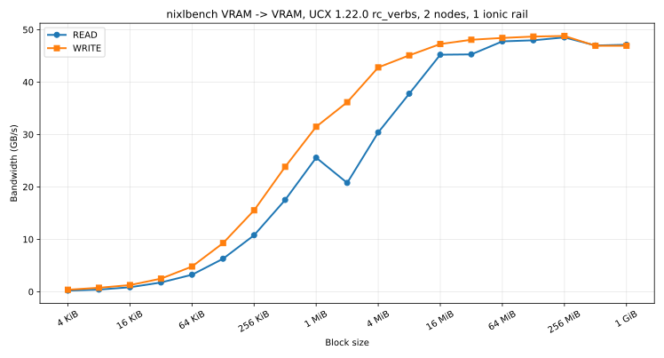

# NIXL + UCX on ionic

Cross-node VRAM-to-VRAM READ and WRITE, on UCX 1.22.0 (current release), over `rc_verbs`. No TCP data path.

Hardware RDMA READ into GPU memory completes and leaves the buffer unchanged. RDMA WRITE into the same GPU registration lands. READ stays a NIXL read: UCX refuses a ROCm GET sink and the peer RDMA-WRITEs into the local GPU buffer.

```text
READ   ucp_get  -> rendezvous RTR -> peer RDMA WRITE -> local VRAM
WRITE  ucp_put  -> RDMA WRITE -> remote VRAM
```

## Build

Two patches on UCX v1.22.0:

| Patch | Why |
|---|---|
| `ucx_ionic_nosrq.patch.py` | ionic reports `max_srq: 0`. Stock `rc_verbs` refuses the device. Per-QP receive queues let RC register. |
| `ucx_rocm_get_via_put.patch.py` | Drops GET bcopy, GET zcopy, and rendezvous GET when the local buffer is ROCm, so `ucp_get` uses the WRITE path above. |

```bash
sbatch --export=ALL,NIXL_SRC=<existing NIXL prefix>,OUT=<new prefix> \
  docs/scripts/build_ucx.sh
```

`NIXL_SRC` supplies `nixlbench` and the NIXL plugin. The script replaces UCX in `OUT`. Confirm the process, not `PATH`:

```text
UCX  INFO  Version 1.22.0 (loaded from /prefix/lib/libucp.so.0)
```

vLLM mounts the same prefix at `/nixl-prefix`.

## Settings used by both nixlbench runs

```bash
export UCX_TLS=rc_verbs,ud_verbs,tcp,self,rocm
export UCX_NET_DEVICES=ionic_0:1,lo
export UCX_IB_GID_INDEX=1
export UCX_UD_VERBS_ETH_DGID_CHECK=n
export UCX_IB_GPU_DIRECT_RDMA=yes
export UCX_RNDV_SCHEME=auto
export UCX_RMA_PPLN_ENABLE=y
export UCX_PROTO_EMULATION_ENABLE=n
```

| Setting | Why it is set |
|---|---|
| `rc_verbs` | RC RMA. The data lane is `rma(rc_verbs/ionic_0:1)`. |
| `ud_verbs` | RC bootstrap. The patched RC transport is connect-to-EP only and needs a connect-to-iface aux transport. Not the data path. |
| `tcp`, `self` | Allowed, not selected. `self` is same-process. A run is RDMA only when no `inter-node` lane contains `tcp/`. |
| `rocm` | Alias for `rocm_copy`, `rocm_ipc`, `rocm_gdr`. Without it UCX treats GPU pointers as host memory. |
| `UCX_NET_DEVICES` | One rail. These NICs only reach the same rail index on the peer. |
| `UCX_IB_GID_INDEX=1` | RoCEv2 GID on this fabric. |
| `UCX_UD_VERBS_ETH_DGID_CHECK=n` | Default `y` drops ionic UD bootstrap packets. |
| `UCX_IB_GPU_DIRECT_RDMA=yes` | Register the GPU buffer with the NIC. |
| `UCX_RNDV_SCHEME=auto` | Does not select the GPU GET path. Left on auto so it does not force `get_zcopy`. |
| `UCX_RMA_PPLN_ENABLE=y` | Turns on RMA rendezvous. Off by default here, and that is the only way the READ workaround is chosen. |
| `UCX_PROTO_EMULATION_ENABLE=n` | Turns off software emulation under about 7 MiB. Left on, small READs pass the byte check at about 0.8 GB/s. |

`docs/scripts/ucx_xnode_worker.sh` passes these into the container, mounts `/boot` read-only (UCX reads the kernel config from there), and mounts the host ionic verbs provider. Both buffers are `hipMalloc` VRAM.

## nixlbench READ

**Command**

```bash
sbatch -w "$NODE0,$NODE1" --export=ALL,OP_TYPE=READ \
  docs/scripts/run_crossNode_ucx.sh
```

The worker runs:

```bash
nixlbench \
  --runtime_type ASIO --asio_address "$TARGET_IP" --asio_port "$TARGET_PORT" \
  --backend UCX \
  --op_type READ \
  --initiator_seg_type VRAM --target_seg_type VRAM \
  --total_buffer_size 1073741824 \
  --start_block_size 4096 --max_block_size 1073741824 \
  --num_iter 16 --warmup_iter 4 \
  --check_consistency 1
```

| Flag | Why, for READ |
|---|---|
| `--op_type READ` | Initiator pulls the target buffer into its own buffer. This is the GET that the patch rewrites. |
| `--initiator_seg_type VRAM --target_seg_type VRAM` | Both ends are GPU memory. Host buffers hide the bug: RDMA READ into host DRAM works. |
| `--check_consistency 1` | The failure mode is a successful completion with stale destination bytes. Bandwidth without this check is not a pass. |
| `UCX_RMA_PPLN_ENABLE=y` | Required. This is what makes UCX pick rendezvous RTR (peer PUT) after the GET sink is refused. |
| `UCX_PROTO_EMULATION_ENABLE=n` | Required for the curve below. The byte check still passes with emulation on; the rate does not. |
| `rc_verbs` + `rocm` | The bytes move as an RDMA WRITE into the initiator GPU, not as a copy through host or TCP. |

`UCX_PROTO_INFO=y` on a READ run prints the selected protocol. The line that matches this recipe is `rendezvous data send from rocm/GPU0 to rocm/dev[0]` on `rc_verbs`.

## nixlbench WRITE

**Command**

```bash
sbatch -w "$NODE0,$NODE1" --export=ALL,OP_TYPE=WRITE \
  docs/scripts/run_crossNode_ucx.sh
```

Same `nixlbench` invocation with `--op_type WRITE`. The initiator's VRAM is RDMA-written into the target's VRAM. The GET patch is not on this path.

| Flag | Why, for WRITE |
|---|---|
| `--op_type WRITE` | `ucp_put` over `rc_verbs`. This is the operation the NIC already performs correctly into VRAM. |
| VRAM on both sides | Same placement as READ, so the two curves differ by direction only. |
| `--check_consistency 1` | Same byte check. |
| `UCX_RMA_PPLN_ENABLE=y` | Not required for WRITE. Kept so READ and WRITE are one binary and one environment. |
| `UCX_PROTO_EMULATION_ENABLE=n` | Same. WRITE does not fall into the slow GET emulation path, and the flag stays so the comparison is honest. |

## Bandwidth

Two nodes, one `ionic_0` rail, VRAM to VRAM, consistency checked, UCX 1.22.0.



| Size | READ GB/s | WRITE GB/s |
|---:|---:|---:|
| 4 KiB | 0.215 | 0.379 |
| 8 KiB | 0.406 | 0.753 |
| 16 KiB | 0.851 | 1.266 |
| 32 KiB | 1.765 | 2.497 |
| 64 KiB | 3.246 | 4.810 |
| 128 KiB | 6.298 | 9.279 |
| 256 KiB | 10.782 | 15.534 |
| 512 KiB | 17.513 | 23.831 |
| 1 MiB | 25.575 | 31.477 |
| 2 MiB | 20.764 | 36.158 |
| 4 MiB | 30.394 | 42.799 |
| 8 MiB | 37.787 | 45.100 |
| 16 MiB | 45.222 | 47.260 |
| 32 MiB | 45.283 | 48.072 |
| 64 MiB | 47.764 | 48.419 |
| 128 MiB | 47.969 | 48.683 |
| 256 MiB | 48.524 | 48.798 |
| 512 MiB | 46.983 | 46.921 |
| 1 GiB | 47.119 | 46.929 |

WRITE is ahead until 16 MiB. Both sit near 48 GB/s from 64 MiB up. The READ dip at 2 MiB is in the measured sweep; that point passed the byte check. Rebuild the figure with:

```bash
python3 docs/scripts/plot_nixlbench_bw.py \
  docs/scripts/logs/read_<job>.bw docs/scripts/logs/write_<job>.bw \
  docs/figures/ucx_ionic_nixlbench_read_write.svg
```

## Disagg

`kv_role` does not select the direction. The connector does. Prefill is `kv_producer`, decode is `kv_consumer`, on both modes.

| Mode | `kv_connector` | Runtime | Wire |
|---|---|---|---|
| READ | `NixlConnector` | `NixlPullConnector` | Decode pulls. UCX GET is served by the peer RDMA WRITE. |
| WRITE | `NixlPushConnector` | `NixlPushConnector` | Prefill RDMA-writes KV into decode VRAM. |

`kv_buffer_device` stays `cuda`. On this ROCm build that is the GPU allocation. `backends` is `UCX` only.

Same process environment as nixlbench, plus:

```bash
export UCX_MODULE_DIR=/nixl-prefix/lib/ucx
export UCX_LOG_LEVEL=info
export VLLM_NIXL_SIDE_CHANNEL_HOST="$HOST_IP"
export VLLM_NIXL_SIDE_CHANNEL_PORT=5600
```

`UCX_MODULE_DIR` is required because the container mounts the prefix at `/nixl-prefix`, not UCX's compiled-in `/prefix`.

### TP8 READ

```bash
vllm serve "$MODEL" \
  --host "$PREFILL_IP" --port 8100 \
  --tensor-parallel-size 8 \
  --trust-remote-code \
  --kv-cache-dtype fp8 \
  --max-model-len 32768 \
  --gpu-memory-utilization 0.85 \
  --kv-transfer-config '{"kv_connector":"NixlConnector","kv_role":"kv_producer","kv_buffer_device":"cuda","kv_load_failure_policy":"recompute","kv_connector_extra_config":{"backends":["UCX"],"kv_lease_duration":180}}'
```

Decode is the same command with `--host "$DECODE_IP" --port 8200` and `"kv_role":"kv_consumer"`.

### TP8 WRITE

Same two commands. The only change is `"kv_connector":"NixlPushConnector"` on both processes. Do not swap producer and consumer.

Each TP rank sets `UCX_NET_DEVICES=ionic_<rank>:1,lo` before the UCX backend is created (`NIXL_UCX_PER_RANK_RAIL=1`). Rank *k* only has a path to rank *k* on the other node.

### EP8

Same connector JSON as the matching TP8 mode. Parallelism replaces TP:

```bash
vllm serve "$MODEL" \
  --host "$PREFILL_IP" --port 8100 \
  -tp 1 \
  --data-parallel-size 8 --data-parallel-size-local 8 \
  --data-parallel-address "$PREFILL_IP" --data-parallel-rpc-port 13345 \
  --enable-expert-parallel \
  --all2all-backend mori_high_throughput \
  --no-enable-prefix-caching \
  --api-server-count 8 \
  --trust-remote-code \
  --kv-cache-dtype fp8 \
  --max-model-len 32768 \
  --gpu-memory-utilization 0.75 \
  --kv-transfer-config '{"kv_connector":"NixlConnector","kv_role":"kv_producer","kv_buffer_device":"cuda","kv_load_failure_policy":"recompute","kv_connector_extra_config":{"backends":["UCX"],"kv_lease_duration":180}}'
```

Decode uses `--all2all-backend mori_low_latency`, its own `--data-parallel-address`, and `"kv_role":"kv_consumer"`. WRITE again only replaces `NixlConnector` with `NixlPushConnector`.

Two EP8-only settings:

| Setting | Why |
|---|---|
| `UCX_NET_DEVICES=ionic_0:1,lo` and `NIXL_UCX_PER_RANK_RAIL=0` | A request's prefill DP rank and decode DP rank do not match. Rails are isolated, so every rank stays on `ionic_0`, the one rail that reaches every peer rank. |
| `UCX_KEEPALIVE_INTERVAL=inf` | Eight ranks sharing one UD receive queue overflow it. UD stays for RC wireup. A dead peer shows up as a failed RDMA op. |

### Router

NIXL workers are not discovered through the router. Pass the servers:

```bash
vllm-router \
  --vllm-pd-disaggregation --kv-connector nixl \
  --prefill "http://$PREFILL_IP:8100" \
  --decode "http://$DECODE_IP:8200" \
  --host 0.0.0.0 --port 30000 \
  --policy round_robin --prefill-policy round_robin --decode-policy round_robin
```

### Results

UCX 1.22.0, GPU KV, inter-node lane `rc_verbs` only.

| Topology | Mode | GSM8K exact_match | Steady KV rate |
|---|---|---:|---|
| TP8 1P1D | READ | 0.92 | 19–35 GB/s, about 31 GB/s late in the run |
| TP8 1P1D | WRITE | 0.98 | 24–34 GB/s |
| EP8 1P1D | READ | 0.94 | not aggregated (8 API servers); lane is `rc_verbs/ionic_0` |
| EP8 1P1D | WRITE | 0.94 | same |

TP8 rates are per transfer (about 24–36 MB, 61 descriptors), after the first sample. Failed transfers: 0. The rate is below the nixlbench plateau because a KV transfer is many small descriptors, not one 64 MiB message.

## Check the data path

`UCX_TLS` is the allow-list. The lane is the selection.

```bash
grep -h 'UCX  INFO  Version' prefill*.log decode*.log | sort -u
grep -h 'inter-node cfg' prefill*.log decode*.log | grep -oE 'rma\([^)]*\)|tcp/' | sort -u
grep -h 'Creating v1 connector' prefill*.log decode*.log
grep -hE 'Num failed transfers=[1-9]|NIXL_ERR' prefill*.log decode*.log
```

Pass looks like `Version 1.22.0`, `rma(rc_verbs/ionic_N:1)`, `NixlPullConnector` or `NixlPushConnector`, and no `tcp/` or `NIXL_ERR` lines.

The READ patch does not make hardware RDMA READ into VRAM work. It stops UCX from using that operation.
